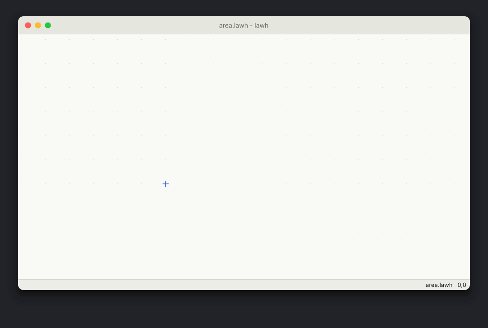

<div align="center">

# lawh

[](https://github.com/y0sif/lawh/actions/workflows/ci.yml)
[](https://github.com/y0sif/lawh/releases)
[](LICENSE)
[](https://www.rust-lang.org)

**A keyboard-driven whiteboard for people who think in Vim.**

</div>

<p align="center">
  
</p>

lawh (لوح, "board" or "slate") is a native, open-source whiteboard and text editor for the
keyboard, written in Rust. You draw shapes, write math and arrange text with Vim motions and
commands instead of a mouse or a pen. Type `:circle r=3` and the circle appears at your cursor.
Type `:math A = pi r^2` and it renders as math, typeset by [Typst](https://typst.app). Jump
between objects with `w` and `HJKL`, or to any object in view with `s` and a short label, take one
with `x` and put it under another with `p`. No drawing tablet, no hunting for toolbar buttons, no
dragging to get the size right.

Whiteboards like Excalidraw and tldraw are built for the mouse: keyboard shortcuts pick a tool, then
you drag. lawh drives the whole canvas with a Vim grammar (modes, counts, operators, motions and
`:` commands). Its boards are plain-text files you keep in git.

## What you can do

lawh 0.1.0 opens a board in a window on Linux, macOS or Windows. You draw on it, write text and
math, move things around and save it as a plain-text file, all from the keyboard, then export it
to SVG, PNG or PDF. The demo above builds the "area of a circle" board and exports it.

- **Modes:** Normal, Insert (inside a text or math block), block-Normal (Vim's Normal mode inside a block), Visual (select objects) and Command (`:`)
- **Canvas cursor** moved with `hjkl` and counts (`5l`), or onto objects with `w`, `b` and `HJKL`. New objects appear at the cursor.
- **Objects:** text block, math block, circle or ellipse, rectangle, line, arrow
- **Commands:** `:circle r=3`, `:rect 4 2`, `:arrow 3 0`, `:text`, `:math`
- **Math** in [Typst](https://typst.app) syntax: `A = pi r^2`, `sum_(i=1)^n i`
- **Editing:** delete, yank and put, undo and redo, `.` to repeat, counts everywhere, Vim editing inside text and math blocks
- **Moving:** take an object with `x` (or `dd`) and put it with `p` below another or `P` above it, as in Vim; on a grid point, `p` puts it at the cursor
- **Sizes:** text and math from 0.25 to 16 times the default size, with `<C-a>` and `<C-x>`, `:size 2`, or `size=2` in the file; math is drawn to match the height of the text beside it
- **Jump labels:** `s` puts a one- or two-character label on every object in view except the current one; type one to jump there, or `ds` and a label to delete a far object without moving
- **Symbol search:** `:sym integral` finds a math symbol by its Typst name, with the best matches shown as you type (fuzzy matching: a name matches when it holds the query's letters in order, not necessarily side by side)
- **Placing:** put objects or a new block below or above another, clear of the rest (`p`, `P`, `o`, `O`, and `:text` or `:math` with the cursor on an object)
- **Files:** plain-text `.lawh` boards that diff cleanly in git, saved atomically with `:w`
- **Export:** `:export board.pdf` draws the board into an SVG, PNG or PDF file, or only a Visual selection; `lawh export board.lawh board.png` does it without a window. Board text in a PDF can be searched and copied
- **Config:** key maps (`:nnoremap` and family) and settings (`:set`) in a `lawhrc`
- **Mouse:** pan, zoom and click to select. Everything else from the keyboard.

Next: a visual design pass over the canvas, the status line and the jump labels.

Out of scope for now: freehand drawing, collaboration, a document view, right-to-left text,
images, plugins.

## Install

### Download a release

Each [release](https://github.com/y0sif/lawh/releases) has an archive for each platform:

| Platform | Archive |
|---|---|
| Linux x86_64 | `lawh-vX.Y.Z-x86_64-unknown-linux-gnu.tar.gz` |
| Linux arm64 | `lawh-vX.Y.Z-aarch64-unknown-linux-gnu.tar.gz` |
| macOS Apple silicon | `lawh-vX.Y.Z-aarch64-apple-darwin.tar.gz` |
| macOS Intel | `lawh-vX.Y.Z-x86_64-apple-darwin.tar.gz` |
| Windows x86_64 | `lawh-vX.Y.Z-x86_64-pc-windows-msvc.zip` |

Each holds the `lawh` binary, this README, `LICENSE`, `THIRD-PARTY-LICENSES.txt` and the licences
of the two bundled fonts. `SHA256SUMS`, next to the archives, lists their checksums:
`sha256sum -c SHA256SUMS --ignore-missing` (or `shasum -a 256 -c SHA256SUMS --ignore-missing` on
macOS) checks the one you downloaded. Put `lawh` somewhere on your `PATH`.

**Linux** needs no extra packages: lawh loads the X11 or Wayland libraries your desktop already
has when it starts. The Linux archives are built on Ubuntu 24.04, whose glibc is 2.39
([Launchpad](https://launchpad.net/ubuntu/noble/+source/glibc), checked 2026-10-25), so glibc
2.39 or newer is enough; the oldest glibc each build needs is printed in the summary of the
release workflow run that built it.

**Windows** needs no Visual C++ Redistributable: the C runtime is linked into `lawh.exe`.

**macOS and Windows** warn the first time you open lawh, because the builds aren't code-signed:

- **macOS 15 and later:** open lawh once and let macOS block it, then go to System Settings,
  Privacy & Security, and click "Open Anyway". Control-click, Open no longer skips the check
  since macOS 15 ([Apple, 2024-08-06](https://developer.apple.com/news/?id=saqachfa), checked
  2026-10-25). Or remove the download's quarantine flag in a terminal:
  `xattr -d com.apple.quarantine lawh`.
- **macOS 14 and earlier:** Control-click lawh in Finder, then Open
  ([Apple's macOS Sonoma 14 guide](https://support.apple.com/guide/mac-help/open-a-mac-app-from-an-unknown-developer-mh40616/14.0/mac/14.0),
  checked 2026-10-25).
- **Windows:** for an unsigned app, SmartScreen says "Windows protected your PC" and you must
  choose "Run anyway" before it runs; an organisation's policy can block it entirely
  ([Microsoft Learn](https://learn.microsoft.com/en-us/windows/apps/package-and-deploy/smartscreen-reputation),
  checked 2026-10-25). "Run anyway" shows after you click "More info"
  ([Microsoft, 2013](https://learn.microsoft.com/en-us/archive/blogs/vsnetsetup/windows-smartscreen-prevented-an-unrecognized-app-from-running-running-this-app-might-put-your-pc-at-risk)).
  On Windows 11, Smart App Control can block unsigned apps (when its cloud service can't vouch
  for the app), and it can only be turned off as a whole, not for one app
  ([Microsoft](https://support.microsoft.com/en-us/topic/what-is-smart-app-control-285ea03d-fa88-4d56-882e-6698afdb7003),
  checked 2026-10-25).

### With cargo

```bash
cargo install --git https://github.com/y0sif/lawh lawh --locked
```

Needs Rust 1.95 or newer and a C compiler, which some dependencies' build scripts use (`psm`,
through Typst). It compiles every dependency, Typst included, so expect minutes, not seconds (see
the cold build time below).

### From source

```bash
git clone https://github.com/y0sif/lawh
cd lawh
cargo run -p lawh -- examples/area.lawh
```

Needs Rust 1.95 or newer and a C compiler (for `psm`, through Typst). Nothing else to install on
Linux: the X11 and Wayland libraries are loaded when lawh starts. A cold debug build takes several
minutes: 479 s on the maintainer's laptop for commit `64c6bf4` (2026-10-10), before export added
more crates (measured, see
[docs/research/m1-measurements.md](https://github.com/y0sif/lawh/blob/main/docs/research/m1-measurements.md#dev-profile)).

## Command line

```text
lawh [file.lawh]
lawh export [--scale N] [--transparent] <board.lawh> <out.svg|png|pdf>
```

`lawh board.lawh` opens the board in a window; a file that doesn't exist yet opens as an empty
board that `:w` creates. `lawh` alone opens an unnamed board.

`lawh export` draws a board into an SVG, PNG or PDF file without a window, the format taken from
the extension. It reads no lawhrc, so a board exports the same on every machine.

| Option | Does |
|---|---|
| `--scale N` | A PNG's scale, from 0.25 to 8 (default 2), as `:set pngscale` |
| `--transparent` | No paper behind the board, as `:set exportbg=none` |
| `-h`, `--help` | Print the help |
| `-V`, `--version` | Print the version |

`lawh export` exits with:

| Exit | When |
|---|---|
| 0 | The file is written |
| 1 | Nothing is written: the board can't be read, the export stopped at a cap, the file is the board itself, or the file can't be written |
| 2 | The arguments are wrong |

Details, and the message each case prints:
[docs/keys.md](https://github.com/y0sif/lawh/blob/main/docs/keys.md#exporting-without-a-window).

## Quick start

Open a new board (the file is created when you write it):

```bash
lawh circle.lawh
```

Then type these 62 keys, each `<...>` being one key, with no lawhrc installed (the sample one
moves with `jkl;`):

```text
5kiArea of a circle<Esc>5j:ci 3<CR>:li 3 0<CR>lkir<Esc>4lj:ma A = pi r^2<CR>:w<CR>
```

| Keys | Does |
|---|---|
| `5k` | Move the cursor 5 grid units up |
| `iArea of a circle<Esc>` | Type the title in a new text block |
| `5j` | Back down to the origin |
| `:ci 3<CR>` | A circle of radius 3 around the cursor |
| `:li 3 0<CR>` | The radius: a line from the circle's centre, 3 units right |
| `lk` | One unit right and one up |
| `ir<Esc>` | The label `r` |
| `4lj` | Four units right, one down |
| `:ma A = pi r^2<CR>` | The formula, rendered with Typst |
| `:w<CR>` | Write `circle.lawh` |

`circle.lawh` now holds the same board as `examples/area.lawh` (a test types these keys and checks
it: `crates/lawh-core/tests/acceptance.rs`). `:q` quits.

To share it as a picture or a document, type `:exp circle.png<CR>` (or `.svg`, `.pdf`) on the
board, or export it from a shell without opening a window:

```bash
lawh export circle.lawh circle.pdf
```

### Key maps and settings

lawh reads `lawhrc` from its config directory at start: `:set` and mapping commands, one a line.
To try the sample, which moves with `jkl;` instead of `hjkl`:

```bash
mkdir -p ~/.config/lawh
cp examples/lawhrc ~/.config/lawh/lawhrc
```

That path is for Linux and macOS; Windows and the file's format are in
[docs/keys.md](https://github.com/y0sif/lawh/blob/main/docs/keys.md#lawhrc).

## Controls

The essentials. Every key and command:
[docs/keys.md](https://github.com/y0sif/lawh/blob/main/docs/keys.md).

| Keys | Does |
|---|---|
| `h` `j` `k` `l` | Move the cursor one grid unit; with a count, `5l` |
| `w` `b`, `H` `J` `K` `L` | Jump to the next or previous object, or the nearest one left, down, up or right |
| `s` then a label | Jump to any object in view by the label shown on it |
| `:circle r=3`, `:rect 4 2`, `:line 3 0`, `:arrow 3 0` | Draw at the cursor |
| `:text Hello`, `:math A = pi r^2` | Text or math at the cursor |
| `i` `a` `o` | Type a new text block, or into the current text or math block |
| `<CR>` | Edit the current text or math block in Vim's Normal mode |
| `<C-a>` `<C-x>` | Make the current text or math block larger or smaller |
| `:sym integral` | Put in a math symbol by name; `<C-k>` while typing in a block |
| `dd` `x` `yy` `p` `P` | Delete, yank, put below or above; `x` then `p` moves an object |
| `v` | Select objects with a rectangle |
| `u` `<C-r>` `.` | Undo, redo, repeat the last change |
| `:w` `:q` `:wq` `:q!` | Write, quit |
| `:export board.pdf` | Export the board (or, from Visual mode, the selection) to SVG, PNG or PDF |
| Mouse | Drag (left or middle button) to pan, scroll to zoom, click to select |

`RUST_LOG=info` prints how long the first frame took.

## The file format

A board is a plain-text [KDL](https://kdl.dev) file. This is `examples/area.lawh`:

```kdl
// The "area of a circle" benchmark board, in grid units.
lawh version=1

text   id=t1 x=0 y=-5 "Area of a circle"
circle id=c1 x=0 y=0 r=3
line   id=l1 x1=0 y1=0 x2=3 y2=0
text   id=t2 x=1 y=-1 "r"
math   id=m1 x=5 y=0 "A = pi r^2"
```

Each kind of object, one per line, as lawh writes it (coordinates in grid units, y down):

```kdl
lawh version=1
text id=t1 x=0 y=-5 "Area of a circle"
math id=m1 x=5 y=0 "A = pi r^2"
circle id=c1 x=0 y=0 r=3
ellipse id=e1 x=0 y=0 rx=3 ry=2
rect id=r1 x=0 y=0 w=4 h=2
line id=l1 x1=0 y1=0 x2=3 y2=0
arrow id=a1 x1=0 y1=0 x2=3 y2=0
```

Text and math sit at the top-left of their box, circles and ellipses at their centre, rectangles
at their top-left corner, and arrows point from `x1,y1` to `x2,y2`. Text and math may take a
`size` after `y` (`text id=t3 x=0 y=-8 size=2 "Title"`): a multiplier on the text height, from
0.25 to 16, written only when it isn't 1. Hand-written files may use comments, any property order
and other KDL string forms; lawh writes this fixed shape. A board holds at most 500 objects and
the file at most 1 MiB. Files must be UTF-8; a leading byte order mark (BOM) is skipped.

The `:` commands use the same names, so `:circle r=3` reads like the line it creates.

## How it works

```text
 file, keys, mouse ──► lawh (window, input, saving, exporting; lawh export)
                         │
                         ▼
                    lawh-core ── board model, .lawh reader and writer,
                         │       Vim engine (modes, : commands, undo, key maps,
                         │       sizes, jump labels, :sym)
                         ▼
                    lawh-render ── draws the board (vello_cpu) with a per-frame work budget,
                         │         and the cursor, selection, jump labels, :sym rows and
                         │         status line over it; exports SVG, PNG and PDF from
                         │         the same draw list
                         │
                         └──► lawh-math ── Typst math → vector paths, compiled in a
                                           sandboxed worker process; Typst's symbol
                                           names for :sym
```

`lawh-core` has no rendering or windowing code, so the Vim engine is tested as plain functions:
keys in, board out. See
[docs/architecture.md](https://github.com/y0sif/lawh/blob/main/docs/architecture.md).

## Project structure

```text
lawh/
├── crates/
│   ├── lawh-core/     # board model, file format and the Vim engine
│   ├── lawh-math/     # Typst math in a sandboxed worker process
│   ├── lawh-render/   # drawing, the editing overlay, and export to SVG, PNG and PDF
│   └── lawh/          # the app: window, keys, mouse, saving, lawh export
├── examples/          # a sample board and a sample lawhrc
├── demo/              # the README demo: its key script and render.sh
├── assets/fonts/      # bundled fonts and their licences
├── assets/licenses/   # notices for data compiled into the binary
├── about.toml         # cargo-about settings for THIRD-PARTY-LICENSES.txt
└── docs/              # architecture, keys, testing, tech stack, comparison, FAQ
```

## How it compares

| | lawh | Excalidraw | tldraw | AFFiNE | qboard |
|---|---|---|---|---|---|
| Vim grammar on the canvas | Yes | No | No | No | No (Vim-style keys for tools) |
| Shapes made and sized from the keyboard | Yes | No | No | No | No |
| Math | Typst | Not built in | SDK example only | LaTeX block | LaTeX |
| File format | Plain-text KDL | JSON | JSON | Yjs (CRDT) documents | JSON |
| Runs as | Native app | Web | Web / SDK | Web / desktop | Web |
| License | MIT | MIT | Source-available | MIT, except the backend | MIT |

Sources for each cell, and more tools, in
[docs/comparison.md](https://github.com/y0sif/lawh/blob/main/docs/comparison.md); see also
[docs/faq.md](https://github.com/y0sif/lawh/blob/main/docs/faq.md).

## Development

```bash
cargo test -p lawh-core                        # fast loop: board model, file format, Vim engine
cargo test --workspace                         # everything, as CI runs it
cargo fmt --all --check
cargo clippy --all-targets -- -D warnings
```

`demo/render.sh` renders the demo above from the app's own frames (needs ffmpeg; see
[demo/README.md](https://github.com/y0sif/lawh/blob/main/demo/README.md)). See
[CONTRIBUTING.md](https://github.com/y0sif/lawh/blob/main/CONTRIBUTING.md).

## License

[MIT](LICENSE). The release archives also carry the bundled fonts' licences (OFL-1.1) and
`THIRD-PARTY-LICENSES.txt` for the Rust crates and data compiled into the binary.
